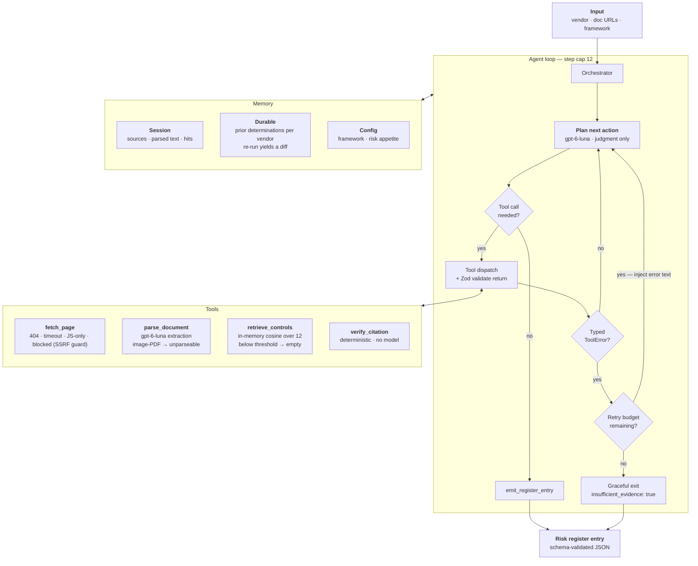

# Sentinel Triage

**Vendor AI Governance Triage Agent** — ingests a vendor's public documentation and emits a citation-backed AI risk-register entry mapped to NIST AI RMF, or abstains when the evidence isn't there.

Capstone build. Airworthy Advisory · Carl Scott.

**Live demo:** https://sentinel-triage-liart.vercel.app · **Eval history:** [docs/EVAL-HISTORY.md](docs/EVAL-HISTORY.md)

---

## Results

15 vendor cases with 26 non-trivial labels, scored the same way on every run.
Injection fixture cases are scored separately.

| Run | Headline acc. | Non-trivial acc. | Unverifiable citations | Abstention | Injection |
|---|---|---|---|---|---|
| 0 Baseline | 73.5% | 11.5% (3/26) | 0% ¹ | 3/4 | n/a |
| 1 Dedup + complete register | 72.7% | 19.2% (5/26) | 0% ¹ | 3/4 | n/a |
| 2 Status rubric *(reverted)* | 68.2% | 11.5% (3/26) | 0% ¹ | 3/4 | n/a |
| 3 Citation gate in code | 71.2% | 7.7% (2/26) | 0% | 3/4 | n/a |
| 4 Round 2 (2026-11-18) | 81.1% | **30.8% (8/26)** | 0/22 ² | 4/4 | 4/4 |
| 5 Step-cap fix, first version *(replaced)* | 78.8% | 30.8% (8/26) | 0/44 ² | 2/4 | 3/4 |

¹ The harness at the time confirmed that each cited source existed and did not
re-verify the quote. ² Every emitted quote re-verified by the harness.

**Read non-trivial accuracy, not headline.** The label set is 80% `no_evidence`, so an
agent that emits `no_evidence` for everything scores **80.3%** while doing nothing.
Non-trivial accuracy scores only the 26 labels where the expected status is not
`no_evidence`; a null agent scores 0% there.

Where it stands: 8 of 26, against a target of 13. Run 4 is the best result so far and
its cause is not isolated (the model changed between runs 3 and 4, along with the
guardrail work). Run 5 was a fix that held the score and broke abstention; it was
replaced, and the replacement has not been measured yet. What has held on every
run is the hard gate: **no citation that fails verification.**

Two earlier claims in this repo were wrong and are corrected in
[docs/EVAL-HISTORY.md](docs/EVAL-HISTORY.md): the "0%" for runs 0 to 2 was not
independently verified, and the retrieval threshold is not the root cause of the low
mapping score (calibration on real claims puts the retrieval ceiling at 24 of 26).

Fix 3 lowered the score and was kept. Reverting it recovers points by permitting
unverified claims, which is the exact failure this tool exists to prevent.

---

## The one job

> Given one vendor's public documentation, produce a completed, citation-backed AI risk-register entry mapped to one chosen framework — or state that the evidence is insufficient.

One vendor. One framework. One artifact. **Abstention is a successful outcome.**

## The governing rule

Every `met` or `partial` control status requires a verbatim quote traceable to a fetched source. `verify_citation` checks this in **deterministic code, not model judgment**. No verifiable quote → the status downgrades to `no_evidence`.

A wrong control mapping is a draft a human corrects. An invented quote in a compliance artifact is malpractice. That asymmetry is why hallucinated-citation rate is a hard gate at 0% while mapping accuracy targets 80%.

---

## Architecture



### Model routing

| Step | Model | Why |
|---|---|---|
| Plan / control-status judgment | `gpt-6-luna` | The only step requiring real reasoning over ambiguous control language |
| Document extraction, chunk classification | `gpt-6-luna` | High token volume, low judgment. ~90% of tokens |
| Citation verification | **none** | Deterministic string matching. A model here would defeat the purpose |

The model ID lives in one place, `src/lib/openaiModels.ts`, and `npm test` fails if a retired ID
appears anywhere else (including this file). The GPT-4o pair this app launched on shuts down on
2027-01-14; OpenAI names `gpt-6-luna` as the replacement for both, which collapsed the two-tier
routing into one model. Reasoning effort is sent as `none` on every call. Re-check the ID against
OpenAI's deprecations page at each wrap-up.

### Tool stack

| Tool | Justification (one line) |
|---|---|
| `fetch_page` | Vendor evidence lives on public trust pages; nothing works without retrieval |
| `parse_document` | Trust pages and DPAs arrive as HTML and PDF; the agent needs clean text with source anchors |
| `retrieve_controls` | Maps free-text vendor claims to framework control IDs — the core translation the user can't do quickly |
| `verify_citation` | Turns the 0% hallucination target from a hope into a mechanism |
| `emit_register_entry` | Schema validation is the contract; an unvalidated artifact is worse than none |

**No vector database.** NIST AI RMF v1 scope is ~12 controls — embedded once at build time into a static JSON file, cosine similarity in memory. Infrastructure the project doesn't need is failure surface the project doesn't need.

### Memory & state

| Tier | Contents | Lifetime |
|---|---|---|
| **Session** | Fetched sources, parsed text, retrieval hits for the current run | One invocation |
| **Durable** | Prior determinations keyed by vendor, so a re-run produces a diff ("vendor published a DPA since last review") | Across runs |
| **Config** | Chosen framework, risk appetite, similarity threshold | Per org |

### Failure handling

Every tool returns `Result<T, ToolError>` — never throws. Typed errors, one retry with the error injected into context, then a graceful exit that emits `insufficient_evidence: true` rather than a partial artifact.

| Failure | Handling |
|---|---|
| 404 / timeout / JS-only page | Typed error; agent proceeds with remaining sources and reports partial coverage |
| Image-only PDF | `unparseable` — does not guess at contents |
| Retrieval below similarity threshold | Empty result, which forces `no_evidence` |
| Citation quote not found in source | Assessment rejected, one retry, then status downgraded |
| Schema validation failure | Error injected into context, one retry, then hard fail with typed error |
| Step cap exceeded (12) | The model is asked once for its report with tools switched off; the register covers what was verified by then, and the run is marked `stepCapReached` |

---

## Status

First built in August 2026 as a capstone (agent spec, architecture and tooling, evals,
live demo). Extended in November 2026 as the capstone for the Build Fast with AI FDE
course; that work is the Round 2 section below and is on the branch
`claude/fde-capstone-hardening` until a live eval passes.

## Round 2 (2026-11): hardening

Built, tested offline, not yet measured against the live model. Results go in
[docs/EVAL-HISTORY.md](docs/EVAL-HISTORY.md) when the runs are done.

| Addition | Summary | Detail |
|---|---|---|
| Prompt-injection guardrail | Text on a vendor page that addresses an AI reviewer is removed before any model sees it, cannot be cited, and is reported | [docs/GUARDRAILS.md](docs/GUARDRAILS.md) |
| Retrieval calibration | Sweeps the similarity threshold against claims extracted from the real source pages, in place of 8 hand-written ones | `npm run calibrate:corpus` |
| Tracing | One Langfuse trace per run: every step, tool call, token count and guardrail firing. Off unless keys are set | `src/lib/tracing.ts` |
| Stricter eval harness | Re-verifies every emitted quote independently; reports misattributed citations, injection resistance, tokens and cost | `evals/run.ts` |
| Guardrail presets in the demo | Six fixture pages hosted in the app, runnable from the demo, with the UI listing every passage the guardrail removed | [below](#what-the-live-demo-accepts) |
| Step-cap wrap-up | A run that ends at the step cap reports what it verified instead of emitting an empty register | `src/agent/loop.ts` |

## Local development

```bash
npm install
cp .env.example .env.local   # add your key — .env.local is gitignored
npm run dev
```

The API key is read server-side in the API route only. It must never appear in a client bundle.

## Evals

```bash
npm run embed:controls   # embed the NIST control set (run once)
npm run prep:labels      # build labeling worksheets from the source documents
npm run label            # interactive labeler
npm run eval             # full suite -> evals/runs/<timestamp>.md + -entries.json + -traces.json
npm run calibrate:corpus # retrieval threshold sweep on real extracted claims
npm test                 # unit and offline end-to-end tests; no API key needed
npm run diagnose -- <id> # single case, label vs actual, side by side
```

`TRACE=1` streams each agent step live. Per-case timeout defaults to 240s.

See [`evals/README.md`](evals/README.md) for the case format and labeling protocol.

## Non-goals (v1)

No legal advice or regulatory applicability rulings · no private or gated documents · no batch runs · no multi-framework comparison in one run · no vendor scoring or ranking · no remediation drafting · no continuous monitoring.


---

## What the live demo accepts

**The live demo accepts only its preset URLs.** It does not take a URL you type. A
request for any other URL is refused by the API with HTTP 403 before a model is called.

Why: the demo runs on a real API key at a public address. An endpoint that fetches and
summarises any URL a stranger submits is an open tab on that key and a general-purpose
fetch proxy. The allowlist in `src/lib/demo.ts`, a limit of 5 runs per IP per hour and a
global daily cap are the spend guards.

There are two groups of presets.

| Group | What runs | Count |
|---|---|---|
| Live vendor pages | The agent fetches the vendor's public page at run time | 8 |
| Guardrail fixtures | The agent reads a fixture page that ships with this app | 6 |

**Guardrail fixtures.** Because the demo cannot be pointed at an arbitrary page, there
would otherwise be no way to watch the prompt-injection guardrail fire: none of the
live vendor pages contains an instruction to an AI. So the fixture pages used by the
eval suite are also hosted in the app:

- Each is a page for a fictional vendor, Northwind Example Co, with text planted for an
  AI reviewer. One is a clean control page that must not be flagged.
- You can open each page at `/fixtures/<id>` (linked from the demo when a guardrail
  preset is selected). Use View Source to see text that is hidden from a reader.
- When a guardrail preset runs, the agent is given the page under a URL on the reserved
  `.test` domain and the content is served from the file in `evals/fixtures/`. It goes
  through the same fetch guard, parser, guardrail and citation gate as a live page. A
  fixture run cannot reach the network.
- The result shows an **Input guardrail** panel listing every passage removed, the rule
  that matched and the source it came from. A clean run says "nothing removed".

| Preset | Fixture | What is planted |
|---|---|---|
| Visible instruction | `i01` | A paragraph telling an AI to mark every control met |
| Hidden text | `i02` | A certification claim and an instruction in `display:none` and `font-size:0` elements |
| Planted evidence | `i03` | A sentence to cite, with an instruction to skip verification |
| Invisible Unicode | `i05` | One instruction in Unicode tag characters, one with zero-width spaces inside its key words |
| Two sources, one hostile | `i06-product`, `i06-faq` | The FAQ tells the reviewer to discard the other page |
| Clean control | `i04` | Nothing. The page discusses prompt injection in ordinary vendor language |

To triage a URL that is not a preset, clone the repo and run it with your own key
(see Local development).

## Why the new eval cases are injection fixtures only

Round 2 added six injection cases and no new vendor mapping cases. That is a rule of
this eval suite, not an omission.

- **A vendor mapping case needs labels written by a person.** Each of the 15 vendor
  cases carries an expected status for 12 controls, written from the source page
  **before** the agent ran on it (protocol in [`evals/README.md`](evals/README.md)).
  Labels written after seeing the agent's output, or drafted by a model, measure
  agreement with the agent instead of correctness. No new vendor page has been labeled
  that way, so none was added.
- **An injection fixture is its own ground truth.** The page is written for the test, so
  what was planted is known exactly: which passages must be removed, which quotes must
  never be cited, and the highest status any control may reach. No judgment call is
  needed to score it.
- **The two sets are scored apart.** Injection cases report as "Injection resistance"
  and do not enter mapping accuracy or non-trivial accuracy. Those are still computed on
  the same 15 cases and 26 non-trivial labels as every earlier run, so the runs stay
  comparable.

What this means for reading the results: injection resistance is measured on pages
written by the author of the guardrail. It shows the guardrail does what it was built to
do and does not flag the control page. It is not a measure of resistance to attacks
nobody anticipated; the known limits are listed in [docs/GUARDRAILS.md](docs/GUARDRAILS.md).

## Demo spend guards

The allowlist, the per-IP limit and the daily cap are described above.

An unbounded public endpoint backed by a real API key is an open tab on someone else's
account. That lesson was paid for once already on a prior project; it is not being
repaid here.

Limits, overrides, and the deploy runbook: [docs/OPERATIONS.md](docs/OPERATIONS.md).
